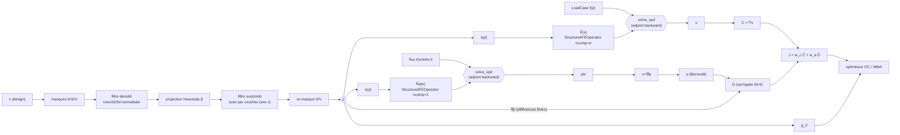

# ARCHITECTURE.md — Architecture logicielle

> Statut : **v0.1.** Décrit comment le code réalise [FORMALISM.md](FORMALISM.md) en respectant
> [CONTRACTS.md](CONTRACTS.md). Périmètre détaillé : la **première brique de résolution statique 2D/3D**
> (grille → opérateur → solveur → adjoint → pipeline de densité) ; les briques fluide, surplomb et
> optimiseur sont conçues au niveau interface.

---

## 1. Vue d'ensemble

**But.** Un solveur d'optimisation topologique pour bras/châssis de drone, où *une seule* fonction
de densité imprimable $\bar\rho$ alimente trois physiques/contraintes (mécanique orthotrope, écoulement potentiel,
auto-support FDM), et où **tous les gradients proviennent d'Autograd**, avec deux seuls backward écrits à la main : les résolutions de systèmes linéaires (adjoint).

**Non-objectifs (v1).** Maillages non structurés ; non-linéarités (géométrique, matériau, contact) ; dynamique ;
CFD visqueuse ; matériaux multiples ; calcul distribué. Voir FORMALISM §9.

**Trois idées directrices**

1. **Un seul opérateur élémentaire générique** (`StructuredFEOperator`) pour mécanique *et* Laplace : grille uniforme ⇒ une seule matrice élémentaire `Ke0` ⇒ produit matrice-vecteur = *gather → petit produit dense → scatter-add*, vectorisé sur tous les éléments.
2. **Autograd partout, sauf à travers les solveurs linéaires** : un `torch.autograd.Function` unique (`solve_spd`) applique la différentiation implicite (adjoint), sans dérouler l'itératif.
3. **Plan précalculé / état léger** : tout ce qui ne dépend pas de $x$ (connectivité, `Ke0`, motif creux, noyaux, masques) est construit une fois ; une itération n'alloue que des champs.

---

## 2. Principes de conception

| Principe | Conséquence concrète |
|---|---|
| Vectorisation totale | Pas de boucle Python sur éléments/nœuds/ddl (C-PERF-01) ; seule boucle admise dans le chemin chaud : couches du filtre de surplomb |
| Pas de matrice élémentaire par élément | `Ke0` unique `(d·2^d)²` ; jamais de tenseur `(Nₑ,24,24)` (C-OP-07) |
| Séparation plan / état | `Problem.plan` immuable ; `Problem.evaluate(x)` pur (sans effet de bord hors cache) |
| Un seul graphe de densité | `rho_bar` est produit **une fois** par `DensityPipeline` et consommé par mécanique et fluide |
| Interfaces par protocoles | `LinearSolver`, `FlowModel`, `Optimizer`, `Material` : remplaçables sans toucher le reste |
| Oracles indépendants | références NumPy naïves dans `tests/reference/`, jamais importées par `src/` |
| float64 / SI | C-CONV-02/03 ; conversion unique dans `scaling.py` |
| Configuration explicite | YAML → dataclasses typées, clés inconnues refusées (C-CFG-01) |

---

## 3. Graphe de calcul



Les deux losanges `solve_spd` sont les **seuls** nœuds à backward manuel.
Tous les autres nœuds sont des opérations `torch` différentiables standard.

---

## 4. Structure du dépôt

```
aeroptimizer/
├── README.md · FORMALISM.md · CONTRACTS.md · ARCHITECTURE.md
├── pyproject.toml · .gitignore
├── configs/                       # cas d'étude YAML
│   ├── mbb_2d.yaml                #   benchmark de validation (poutre MBB)
│   ├── cantilever_3d.yaml         #   console 3D (validation 3D)
│   └── drone_arm_2d.yaml          #   bras de drone, coupe (x,z)
├── src/aeroptimizer/
│   ├── __init__.py · errors.py · config.py · scaling.py
│   ├── grid.py                    # Grid, Connectivity (edof), masques D/S/V
│   ├── materials.py               # Isotropic, Orthotropic, TransverselyIsotropic
│   ├── fem/
│   │   ├── elements.py            # fonctions de forme Q1, Gauss, Ke0 (méca), Ke0 (Laplace)
│   │   ├── operators.py           # StructuredFEOperator : matvec / csr / diag / dK_contract
│   │   ├── bc.py                  # Dirichlet, LoadCase, charges réparties
│   │   ├── solvers.py             # LinearSolver : ScipyDirect, TorchCG (+ préconditionneurs)
│   │   └── adjoint.py             # solve_spd : torch.autograd.Function (adjoint)
│   ├── topopt/
│   │   ├── density.py             # DensityPipeline : masques, filtre, projection, SIMP
│   │   └── overhang.py            # filtre de surplomb (scan par couches)
│   ├── flow/
│   │   ├── base.py                # FlowModel (protocole), FlowState
│   │   ├── potential.py           # PotentialFlow : κ(ρ̄), flux d'entrée, résolution, v
│   │   └── aero.py                # pression de Bernoulli, force diffuse, surrogate D
│   ├── objectives/
│   │   ├── mechanical.py          # compliance
│   │   ├── aerodynamic.py         # D̂ (+ option blockage)
│   │   ├── constraints.py         # fraction volumique
│   │   └── composite.py           # J = Σ w_i Ĵ_i, cache d'état, normalisation figée
│   ├── optim/
│   │   ├── oc.py · mma.py         # optimiseurs
│   │   ├── continuation.py        # calendriers p, β, β_s
│   │   └── loop.py                # boucle d'optimisation, critères d'arrêt
│   ├── problem.py                 # Problem : construit le plan, expose evaluate(x)
│   └── io/                        # results.py (run dir, CSV, provenance) · vtk.py
├── tests/
│   ├── conftest.py
│   ├── unit/ · integration/       # un fichier par module ; stubs générés depuis CONTRACTS.md
│   └── reference/                 # oracles NumPy naïfs (top88, surplomb, Ke0, Laplace)
├── benchmarks/bench_2d.py
└── scripts/
    ├── run.py                     # python scripts/run.py configs/mbb_2d.yaml
    └── contracts_index.py         # indexe/valide CONTRACTS.md ↔ tests, génère les stubs
```

Règle de dépendance (flèche = « peut importer ») :

```
errors, scaling ← grid ← materials, fem.elements ← fem.operators ← fem.bc, fem.solvers ← fem.adjoint
                  grid ← topopt.* ;  fem.* ← flow.* ;  topopt, fem, flow ← objectives ← problem ← optim, io
```

`topopt` n'importe **pas** `fem.solvers` ; `flow` n'importe **pas** `topopt` ; `optim` ne connaît ni `torch` ni `fem` (il reçoit `f, df, g, dg` en `numpy`). Une violation est une erreur de revue.

---

## 5. Conception des modules

### 5.1 `grid.py` — grille, connectivité, masques

```python
@dataclass(frozen=True)
class Grid:
    shape: tuple[int, ...]        # (nx, nz) ou (nx, ny, nz) ; dernier axe = build axis
    h: tuple[float, ...]          # pas par axe [m]

    @property
    def d(self) -> int: ...
    n_elems: int; n_nodes: int
    def n_dofs(self, ncomp: int) -> int: ...

class Connectivity:
    """Plan topologique : indépendant de la densité."""
    edof: Tensor      # (Nₑ, ncomp·2^d) int64
    def __init__(self, grid: Grid, ncomp: int, device): ...
```

Construction de `edof` **sans boucle** : indices nodaux de l'élément de coin bas `i = (i₀,…)`, puis
`node(i + bits(a))` par broadcasting sur les `2^d` décalages binaires ; puis `ddl = ncomp·node + c`.
Pour la mécanique `ncomp=d`, pour le potentiel `ncomp=1` : même fonction.

### 5.2 `fem/operators.py` — l'opérateur générique

État précalculé : `edof (Nₑ, m)` avec `m = ncomp·2^d`, `Ke0 (m, m)`, `fixed_mask (N,)`, motif CSR.

```python
def matvec(self, w: Tensor, u: Tensor) -> Tensor:
    """y = K̃(w) u,  K̃ = P K P + (I-P)   [FORMALISM §3.4]"""
    free = self.free_mask                       # bool (N,)
    ue = (u * free)[self.edof]                  # gather  (Nₑ, m)
    fe = (ue @ self.Ke0) * w[:, None]           # Ke0 symétrique ; jamais (Nₑ,m,m)
    y = torch.zeros_like(u).index_add_(0, self.edof.reshape(-1), fe.reshape(-1))
    return y * free + u * (~free)               # identité sur les ddl bloqués
```

* Un `matmul (Nₑ,m)@(m,m)` : sur GPU c'est un GEMM dense, très efficace ; sur CPU, BLAS.
* `index_add_` sur un tenseur **local fraîchement alloué** : conforme à C-CONV-08, et différentiable en `u` et `w` (Autograd sait dériver `index_add`).
* `diag(w)` : `index_add` de `w[:,None] * diag(Ke0)` ; ddl bloqués → 1.
* `dK_contract(lam, u) -> (Nₑ,)` : `((lam_e @ Ke0) * u_e).sum(-1)` avec vecteurs masqués (C-OP-05). C'est **l'unique** contraction utilisée par l'adjoint.
* `assemble_csr(w)` : le motif (`indptr, indices`) et la table `pos: (Nₑ·m²,) → slot CSR` sont précalculés au plan (tri, `unique` avec `return_inverse`) ; à chaque itération `data = zeros(nnz).index_add_(0, pos, (w[:,None,None]*Ke0).reshape(-1))`. Le tenseur `(Nₑ,m,m)` n'existe **que** dans ce chemin (utile aux solveurs directs ; coût mémoire assumé, 2D uniquement en pratique). Les ddl bloqués : lignes/colonnes mises à zéro et diagonale à 1.

`StructuredFEOperator` ne connaît ni SIMP, ni physique : `w` est le facteur par élément qu'on lui donne (`s` ou `κ`).

### 5.3 `fem/solvers.py` — solveurs linéaires

```python
class LinearSolver(Protocol):
    def prepare(self, op: StructuredFEOperator, w: Tensor) -> SolveHandle: ...

class SolveHandle(Protocol):
    def solve(self, b: Tensor) -> Tensor: ...     # K̃ y = b ; réutilisable (adjoint, multi-RHS)
```

| Backend | Où | Méthode | Usage |
|---|---|---|---|
| `ScipyDirect` | CPU, float64 | `scipy.sparse.linalg.splu` sur CSC (`SymmetricMode=True`, `permc_spec="MMD_AT_PLUS_A"`) ; factorisation **gardée** dans `Handle` | **référence**, 2D, petits 3D (≲ 50 k ddl) |
| `TorchCG` | CPU/CUDA, matrix-free | gradient conjugué préconditionné ; `matvec` de §5.2 | grands 3D |
| préconditionneurs (`TorchCG`) | — | Jacobi (`diag`) en phase 2 ; **multigrille géométrique** (restriction/prolongation Q1 sur grille structurée, lissage Jacobi/Chebyshev) en phase 6 | contraste de $10^{9}$ et finesse |

Remarques :

* **Pourquoi pas `torch.sparse` + `torch.linalg.solve` ?** Les solveurs creux de PyTorch ne couvrent pas proprement le cas SPD de grande taille sur GPU ; l'approche matrix-free évite la dépendance et réduit la mémoire.
* Le CG simple est **mal conditionné** ($\varepsilon_s=10^{-9}$, 3D) : Jacobi est un point de départ, **pas** une solution (voir risque R2). Ne pas promettre le passage 3D GPU avant la phase 6.
* `Handle` stocke la factorisation pour la **résolution adjointe gratuite** (C-SOLVE-01).
* Reprise de convergence : le `TorchCG` démarre de la solution précédente (warm start) à l'intérieur d'une phase de continuation.

### 5.4 `fem/adjoint.py` — la seule dérivée écrite à la main

```python
class SolveSPD(torch.autograd.Function):
    @staticmethod
    def forward(ctx, w, f, op, solver):
        handle = solver.prepare(op, w.detach())
        u = handle.solve(f.detach() * op.free_mask)
        ctx.op, ctx.handle = op, handle
        ctx.save_for_backward(u)
        return u

    @staticmethod
    def backward(ctx, g_u):
        (u,) = ctx.saved_tensors
        lam = ctx.handle.solve(g_u * ctx.op.free_mask)       # K̃ symétrique ⇒ K̃ᵀ = K̃
        grad_w = -ctx.op.dK_contract(lam, u)                  # (Nₑ,)   −λₑᵀ Ke0 uₑ
        grad_f = lam * ctx.op.free_mask                       # P λ
        return grad_w, grad_f, None, None
```

* `grad_w` est le gradient **par rapport au facteur élémentaire `w`**, que la chaîne Autograd en amont (`s(ρ̄)`, `κ(ρ̄)`, filtres, surplomb…) prolonge jusqu'à `x`.
* `u` est sauvegardé (pas de graphe interne), la mémoire est celle d'un vecteur.
* **Test clé** (C-SOLVE-05/06) : `gradcheck` en float64 et comparaison à $-p\bar\rho^{p-1}u_e^\top K_e^0u_e$.
* Multi-cas de charge (phase ultérieure) : `f` de forme `(N, n_lc)` ; le backward est inchangé (résolutions groupées).

### 5.5 `topopt/overhang.py` — scan par couches

```python
def overhang_filter(rho_hat, *, beta_s, eps, stencil) -> Tensor:
    """FORMALISM §2.4. Axe de fabrication = dernier axe.  rho_hat: (*lateral, nz)"""
    nz = rho_hat.shape[-1]
    layers = [rho_hat[..., 0]]                                # plateau : supporté
    for l in range(1, nz):                                    # ≤ nz itérations
        cand = shifted_stack(layers[-1], stencil)             # (*lateral, n_st), bords = 0
        Xi = torch.logsumexp(beta_s * cand, dim=-1) / beta_s - math.log(cand.shape[-1]) / beta_s
        a, b = rho_hat[..., l], Xi
        layers.append(0.5 * (a + b - torch.sqrt((a - b) ** 2 + eps) + math.sqrt(eps)))
    return torch.stack(layers, dim=-1)
```

* `shifted_stack` : `F.pad` (zéros) puis découpages — **pas** de boucle sur les cellules latérales ; 2D = 3 décalages `{-1,0,+1}`, 3D = croix à 5 points (FORMALISM §2.4 ; C-OVH-04).
* **Coût** : `nz` petites opérations vectorisées sur la couche (`O(n_lateral)`), + mémoire Autograd `O(nz·n_lateral·n_st)`. Pour `120×40×20` : 20 couches × 4800 cellules × 5 — négligeable. Le goulot sera le nombre de lancements de kernels GPU, pas la mémoire ; si `nz` grandit, regrouper les couches par `torch.compile` ou un kernel dédié.
* **Rétropropagation** : la sensibilité d'une couche dépend de toutes les couches inférieures, Autograd l'obtient en parcourant la boucle à l'envers.
* **Risque d'optimisation** (R4) : les filtres de surplomb tendent à stagner dans des minima médiocres ; continuation sur `β_s` et sur `β`, éventuellement initialisation *pré-supportée*.

### 5.6 `topopt/density.py` — pipeline de densité

```python
class DensityPipeline(nn.Module):
    def __init__(self, grid, masks, *, R, beta=1.0, eta=0.5, p=1.0, overhang: OverhangCfg | None): ...
    def forward(self, x: Tensor) -> Tensor:                    # -> rho_bar (grid shape)
        rho   = x * self.m_D + self.m_S                        # arithmétique, pas de where (piège NaN)
        rt    = self.filter(rho)                               # conv normalisée
        rh    = self.project(rt)                               # Heaviside β
        rb    = self.overhang(rh) if self.overhang else rh
        return rb * self.keep + self.m_S                       # keep = 1 − m_S − m_V
```

* Filtre : un `F.conv2d/conv3d` avec noyau précalculé (`(1,1,*k)`), padding zéro, et division par le même filtre appliqué à `1` (précalculé).
* `β`, `p`, `β_s` sont des attributs mutables (C-PROJ-03) pilotés par `continuation.py`.
* `simp(rho_bar, p, eps_s)` et `kappa(rho_bar, q, kappa_min)` sont des fonctions pures dans le même module.

### 5.7 `flow/` — fluide

```python
class FlowModel(Protocol):
    def solve(self, rho_bar: Tensor) -> FlowState: ...

@dataclass
class FlowState:
    phi: Tensor            # (Nn,)
    v: Tensor              # (Nₑ, d)  au centre d'élément
    p_rel: Tensor          # (Nₑ,)    p − p∞  (Bernoulli)
```

`PotentialFlow` : `κ(ρ̄)` → `op.matvec` / `solve_spd` (même `StructuredFEOperator` avec `ncomp=1` et `Ke0 = laplace_ke0(h)`), second membre `b` précalculé à partir du profil d'entrée (assemblage de surface sur la face `z=zmax`). `aero.py` : $\nabla\bar\rho$ par différences finies centrées (`torch.gradient`, ou convolution avec noyau de Sobel pour éviter le biais de bord), puis $D$ selon FORMALISM §4.6. `FlowModel` permet de remplacer plus tard par Brinkman–Stokes (P1).

### 5.8 `problem.py` et `objectives/` — assemblage

```python
class Problem:
    plan: Plan                            # Grid, Connectivity, Ke0, ops, masques : immuable
    def evaluate(self, x: Tensor) -> EvalResult:
        st = EvalState(self, x)           # cache paresseux : rho_bar, u, flow
        terms = {name: obj(st) for name, obj in self.objectives.items()}
        J = sum(w[name] * terms[name] / self.refs[name] for name in terms)
        g = [c(st) for c in self.constraints]
        return EvalResult(J=J, g=g, terms=terms, state=st)
```

* `EvalState` garantit **une seule** résolution mécanique et **une seule** résolution fluide par évaluation (C-OBJ-01).
* `refs` sont gelés après la phase d'initialisation (C-OBJ-03).
* `backward` : `J.backward()` pour obtenir `df`, idem pour `g` ; l'optimiseur reçoit `numpy`. Pour une contrainte unique (volume), une rétropropagation distincte suffit.

### 5.9 `optim/` — optimiseurs et boucle

* `OC` : mise à jour classique (bissection sur le multiplicateur, déplacement `m=0.2`, amortissement `η=0.5`), pour valider la chaîne sur MBB.
* `MMA` : implémentation maison (Svanberg, sous-problème dual, 1 contrainte), recoupée avec `OC` sur le cas mono-contrainte ; `nlopt LD_MMA` en recoupement optionnel.
* `continuation.py` : calendriers (`p: 1→3`, `β: 1→β_max`, `β_s`) ; changement ⇒ réinitialisation de l'historique de l'optimiseur (C-OPT-04).
* `loop.py` : `run(problem, optimizer, schedule, callbacks) -> RunResult` ; écrit `history.csv`, `config.resolved.yaml`, `rho_bar.npy` (C-IO-01).

---

## 6. Données, configuration, résultats

`configs/*.yaml` → `config.py` (`dataclass`, stricts). Exemple de structure :

```yaml
grid:     {shape: [120, 40], h: [0.5e-3, 0.5e-3]}      # (nx, nz) [m]
material: {type: transversely_isotropic, Ep: 2.4e9, Ez: 1.8e9, nup: 0.35, nupz: 0.35, Gz: 0.7e9}  # TODO: calibrer
physics:  {plane: stress, thickness: 8.0e-3}
density:  {R: 1.5e-3, p: [1, 3], beta: [1, 16], eta: 0.5, overhang: {theta_deg: 45, beta_s: [10, 80], eps: 1.0e-4}}
flow:     {model: potential, rho_air: 1.225, k_w: 1.4, U_inf: 0.0, n_pad: 6, kappa_min: 1.0e-6, q: 3, c_b: 0.3}  # TODO: calibrer
loads:    {thrust_N: 8.0, load_factor: 1.0}
objective:{w_c: 1.0, w_a: 0.0, volume_fraction: 0.4}
optim:    {method: oc, max_iter: 300, tol: 1.0e-3}
runtime:  {device: cpu, dtype: float64, seed: 0}
```

Dossier de run : `runs/<date>_<cas>/` avec `config.resolved.yaml`, `history.csv`, `rho_bar.npy`, `fields.vti` (optionnel), `provenance.json` (git hash, versions).

---

## 7. Plateformes et performances

| Sujet | Décision |
|---|---|
| Machine de dev (macOS) | **CPU float64** est la plateforme de référence. **MPS ne supporte pas `float64`** : refus explicite (C-SOLVE-09). Ne **pas** faire de dev numérique sur MPS en float32 sans le signaler. |
| GPU (CUDA) | Ciblé pour 3D (phase 6) ; float64 sur GPU grand public est lent (ratio 1:32 à 1:64) : prévoir float32 + raffinement itératif ou GPU « compute ». |
| Budget 2D `300×100` | 30 k éléments, 61 k ddl : `edof` ≈ 1.9 MB ; factorisation directe CPU : ≲ 1 s |
| Budget 3D `120×40×20` | 96 k éléments, 313 k ddl : `edof (96 000×24)` ≈ 18 MB ; `matvec` ≈ quelques centaines de MB ; la **factorisation 3D** devient lourde (fill-in) ⇒ CG-multigrille |
| Parallélisme CPU | BLAS multithread pour le GEMM ; `index_add_` mono-thread par défaut (à mesurer) |
| Mesure | `history.csv` consigne `t_it` ; `benchmarks/bench_2d.py` |

---

## 8. Pile logicielle et outillage

* Python ≥ 3.11 ; `torch ≥ 2.3` ; `numpy`, `scipy`, `pyyaml`. Optionnels : `pyvista`/`meshio` (VTK), `nlopt` (recoupement MMA).
* Qualité : `pytest`, `ruff` (lint + format), `mypy` (strict sur `fem/` et `topopt/`), `pre-commit` (à ajouter).
* Intégration continue : `pytest -m "not slow and not gpu"` + `python scripts/contracts_index.py --check` (chaque contrat a son test).
* Gestion de version : git initialisé dès le jour 0 (le répertoire n'est pas encore un dépôt).

---

## 9. Feuille de route (≈ 1 mois)

Chaque phase est fermée par des **critères de sortie** = contrats dont les tests passent. Les tests des phases futures sont `skip(reason="phase N")`.

| Phase | Semaine | Contenu | Critères de sortie |
|---|---|---|---|
| **0** | J0–J1 | Documents, squelette, génération des stubs de tests, git | `contracts_index.py --check` OK ; `import aeroptimizer` OK |
| **1 — brique statique** | S1 | `Grid`/`Connectivity`, `Ke0` (2D/3D, iso+ortho), `StructuredFEOperator` (matvec, CSR, diag, dK), BC/charges, `ScipyDirect`, `SolveSPD` | C-GRID, C-MAT, C-ELEM-01..05, C-OP, C-BC, C-SOLVE-01..06,08 ; **console 2D vs poutre analytique** |
| **2 — SIMP + filtres + OC** | S1–S2 | `DensityPipeline`, OC, boucle, I/O, `TorchCG` Jacobi, 3D console | C-FILT, C-PROJ, C-SIMP, C-MASK, C-OPT-01..05, C-IO ; **MBB = top88 ±2 %** |
| **3 — orthotropie FDM** | S2 | Étude d'influence $E_z/E_p$, axe de fabrication, comparaison iso/ortho | tests C-MAT/C-ELEM ortho ; figure : topologie vs ratio |
| **4 — aérodynamique** | S2–S3 | `laplace_ke0`, `PotentialFlow`, `aero.py`, validations (uniforme, cylindre, d'Alembert), convergence maillage | C-FLOW, C-AERO ; gradcheck de $D$ |
| **5 — surplomb** | S3 | `overhang_filter` 2D puis 3D, référence NumPy, continuation $\beta_s$ | C-OVH ; MBB auto-supporté sans supports |
| **6 — couplage** | S4 | `Composite`, MMA, balayage Pareto $w_a/w_c$, cas bras 2D, démo 3D | C-OBJ, C-DIFF-01/02 ; **front de Pareto et rapport** |
| *Étirement* | S4+ | Contrainte de rupture (Tsai–Hill) ; CFD de recoupement ; multigrille GPU | optionnel |

**Ordre de sacrifice si le temps manque** (du premier au dernier à couper) : multigrille GPU → contrainte de rupture → démo 3D couplée → MMA (garder OC + pénalité) → surplomb 3D (garder 2D). Le noyau non négociable est : phases 1, 2, 4 et surplomb 2D.

---

## 10. Registre des risques

| # | Risque | Prob. | Impact | Mitigation |
|---|---|---|---|---|
| R1 | Pas de traînée en potentiel pur (d'Alembert) → $D$ = indicateur dépendant de $c_b$ | **certaine** | élevé | Surrogate §4.6, test C-AERO-01, comparaison qualitative à CFD sur 2–3 formes, vocabulaire honnête dans le rapport |
| R2 | Solveur 3D (conditionnement, fill-in direct) | élevée | élevé | 3D en fin de parcours ; multigrille ; viser 2D robuste d'abord |
| R3 | MPS sans float64 | certaine (Mac) | moyen | CPU float64 de référence, DeviceError explicite |
| R4 | Filtre de surplomb : minima médiocres, gradients pathologiques | moyenne | élevé | LSE (gradient fini), continuation $\beta_s$, initialisation pré-supportée, tests C-OVH-07/09 |
| R5 | Paramètres matériau non calibrés ($E_z$, $G_z$, $c_b$…) | élevée | moyen | Marqués ⚠, présents dans les sorties (C-AERO-06), balayages de sensibilité |
| R6 | Orthotropie en raideur seule ≠ fragilité réelle | certaine | élevé (scientifique) | H3 documenté ; contrainte de rupture en étirement |
| R7 | $D$ dépend du maillage (arêtes, cellules d'interface) | moyenne | moyen | C-FLOW-08, $\beta$ élevé, correction d'interface optionnelle |
| R8 | Périmètre d'un mois | élevée | élevé | Ordre de sacrifice §9 ; critères de sortie par phase |
| R9 | `torch.where` / `sqrt(0)` → NaN en gradient | moyenne | moyen | Arithmétique masquée, `eps` partout, C-DIFF-04, `test_no_nan_trajectory` |
| R10 | Dérive de normalisation en cours d'optimisation | faible | moyen | `refs` gelés (C-OBJ-03) |

---

## 11. Journal des décisions (ADR condensé)

| # | Décision | Alternatives écartées | Raison |
|---|---|---|---|
| D-01 | Grille uniforme par axe, Q1 | maillage non structuré, Q2 | `Ke0` unique, vectorisation totale, même grille pour méca/fluide |
| D-02 | Opérateur générique `ncomp` | assembleurs séparés | une seule implémentation à valider, adjoint commun |
| D-03 | Adjoint implicite (`autograd.Function`) | dérouler CG ; dérivées analytiques ; `torch.linalg.solve` creux | mémoire, précision, couvre tout couplage ; une seule dérivée manuelle |
| D-04 | « Identité sur ddl bloqués » | suppression/renumérotation des ddl | matrice SPD de taille fixe, matrix-free trivial, adjoint symétrique |
| D-05 | Axe de fabrication = dernier axe | `build_axis` configurable | élimine une classe entière de bugs ; rotation faite en amont |
| D-06 | Filtre de densité par convolution | Helmholtz | vectorisé, sans solve, standard (top88) ; Helmholtz plus tard si utile |
| D-07 | Surplomb : LSE + smin, stencil en croix en 3D | P-norme de Langelaar ; stencil carré | gradient fini quand tout est nul ; garantie 45° dans toutes les directions |
| D-08 | Traînée = surrogate Bernoulli + pression de culot | potentiel pur ; blocage seul ; Brinkman–Stokes d'emblée | d'Alembert ; Stokes visqueux plus coûteux, reporté (P1) |
| D-09 | float64, SI à l'interface, réduit à l'intérieur | float32 ; unités mm | conditionnement ; clarté |
| D-10 | Couplage unilatéral par la géométrie | couplage fort pression→charge | pression négligeable pour la structure (FORMALISM §5.1) ; extension prévue (C-SOLVE-04) |
| D-11 | MMA maison | dépendre de `nlopt` | interface `step()` ; maîtrise du reset de continuation |
| D-12 | Config YAML + dataclasses strictes | Hydra, dict libre | reproductibilité, erreurs précoces |
| D-13 | Contrats → stubs de tests générés | tests écrits au fil de l'eau | traçabilité garantie ; squelette = liste de travail |
